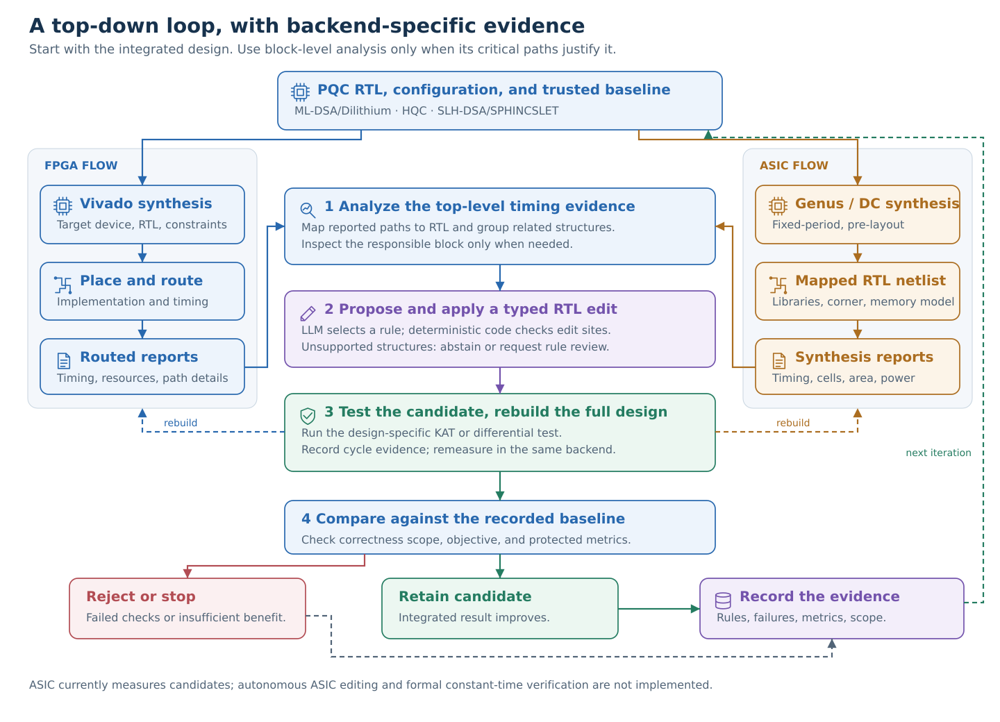

<p align="center"></p>

<p align="center">
<a href="#quick-start">Quick start</a> · <a href="docs/README.md">Documentation</a> ·
<a href="agent/README.md">Agent</a> · <a href="asic/README.md">Genus / DC</a> ·
<a href="docs/findings/INDEX.md">Results of record</a>
</p>

# LLM-Aided-PQC

**Report-guided RTL optimization for post-quantum cryptographic hardware.**

Start from existing RTL, locate a top-level timing bottleneck, and ask an LLM to propose a constrained edit. Deterministic code applies the edit, runs design-specific tests, rebuilds the complete design, and evaluates the result. Investigate a submodule only when top-level evidence justifies it.

The repository contains FPGA experiments for ML-DSA/Dilithium, HQC, and SLH-DSA/SPHINCSLET, plus ASIC synthesis experiments. Historical measurements and their limitations remain in the [findings index](docs/findings/INDEX.md). This software update does not regenerate or certify those results.

## Current capabilities

| Flow | Tool | Status |
|---|---|---|
| FPGA measurement and supported edit dispatch | AMD Vivado | Existing design-specific flow with transactional rollback and source checks |
| Fixed-period ASIC logic synthesis | Cadence Genus | Configurable generated flow; licensed site qualification required |
| Fixed-period ASIC logic synthesis | Synopsys Design Compiler | New generated flow; mock-tested, licensed qualification required |
| ASIC place-and-route or autonomous ASIC edits | Not implemented in the new runner | Future integration |

> [!IMPORTANT]
> This is research software. Functional tests cover exercised inputs, not all-input equivalence, constant-time security, or physical leakage. Some legacy FPGA scripts retain site-specific external source paths. EDA tools, licenses, PDKs, and compiled libraries are not distributed here.

## Framework



**Measure → locate → propose → apply → check → rebuild → decide.**

The FPGA driver snapshots all configured source trees and its checkpoint before dispatch. A rejected or failed candidate restores the pre-run files, including existing local changes. Candidate source hashes must remain unchanged across testing and implementation. HQC joint simulation now stages a private workspace rather than copying over the live candidate.

These safeguards protect cooperating workflows, not hostile executables. Use a dedicated checkout; do not run unrelated jobs in it concurrently. The ASIC runner measures a supplied RTL version only. It does not call the LLM, modify RTL, or automatically admit an optimization.

## Quick start

### FPGA

Use Python 3.10 or later on Linux, a working Vivado installation, and the source dependencies in the [reproduction guide](docs/REPRODUCE.md). Model calls additionally require `anthropic` and `ANTHROPIC_API_KEY`; never commit credentials.

```bash
git clone https://github.com/hsc-research/LLM-Aided-PQC.git
cd LLM-Aided-PQC

# Show the intended command without launching Vivado.
python3 -m agent.run --target fpga --design hqc --dry-run

# Measure the complete design and recommend a target. This launches Vivado.
python3 -m agent.run --target fpga --design hqc

# One supported proposal, test, and full-design reimplementation round.
python3 -m agent.run --target fpga --design hqc --dispatch
```

HQC top-level candidate verification requests all three security levels. Direct `joint_kat_gate.py` calls still default to HQC-128. ML-DSA's full-design test exercises key generation; SLH-DSA's generic dispatch remains unavailable. Read the [agent guide](agent/README.md) before automated runs.

### Choose an ASIC synthesis tool

Copy and edit [the example configuration](configs/butterfly_asic.example.json). Supply `ASAP7_LIB_DIR` for Genus `.lib` files or `ASAP7_DB_DIR` for matching compiled DC `.db` files, and review the example SDC. Libraries must come from your own installation.

```bash
# Inspect generated Tcl. Declared input and library files must exist.
python3 -m agent.run --target asic --synth-tool genus \
  --config configs/butterfly_asic.example.json --dry-run

# Cadence Genus
python3 -m agent.run --target asic --synth-tool genus \
  --config configs/butterfly_asic.example.json

# Synopsys Design Compiler
python3 -m agent.run --target asic --synth-tool dc \
  --config configs/butterfly_asic.example.json
```

`--synth-tool` overrides the configuration's `synthesis_tool`. Missing tools or licenses fail the run; there is no fallback to another vendor. See [ASIC setup, units, and outputs](asic/README.md).

## Documentation

| Need | Start here |
|---|---|
| Agent entry points and verification scope | [Agent README](agent/README.md) |
| Genus or Design Compiler configuration | [ASIC README](asic/README.md) |
| Historical reproduction | [Playbook](docs/REPRODUCE.md), then [dated findings](docs/findings/INDEX.md) |
| Transformation rules | [Optimization taxonomy](docs/02_optimization_taxonomy.md) |
| New-design onboarding | [Architecture guide](docs/AGENT_ARCHITECTURE.md) |
| Fixes, tests, and remaining limits | [Update notes](docs/UPDATE_NOTES.md) |
| All guides | [Documentation hub](docs/README.md) |

## Tests

```bash
python3 -m unittest discover -s tests -v
```

The regression suite uses temporary files, mock tool executables, and Tcl command stubs. It requires Python and `tclsh`, but no API key or EDA license. It does not establish actual synthesis, simulation, PPA, or compatibility with every EDA release.

## Licensing and attribution

See [LICENSE](LICENSE) and [NOTICE](NOTICE). Preserve upstream source headers and licensing terms. Existing records distinguish human-authored changes, agent-selected rules, and agent-proposed extensions. ML-KEM remains a future onboarding target in this snapshot.
