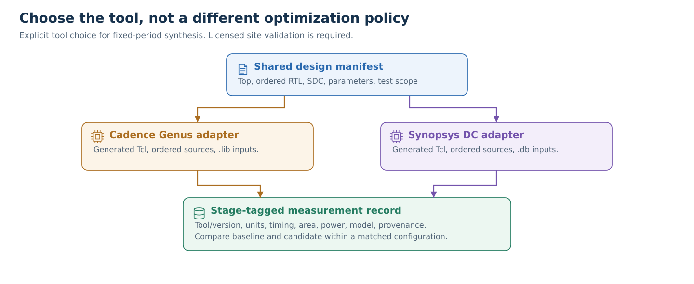

# ASIC synthesis: choose Genus or Design Compiler

[Project](../README.md) · [Documentation](../docs/README.md) · [Agent](../agent/README.md)



## What is implemented and verified

`agent/asic_synthesis.py` prepares **fixed-period, single-clock, pre-layout logical synthesis** for an explicitly selected Genus or Synopsys Design Compiler installation. It reads an ordered HDL manifest, includes, defines, parameters, libraries, data files, and SDC. It isolates runs, records input hashes, checks process completion and report evidence, and parses supported timing/area/power syntax.

Offline tests cover execution failures, malformed reports, units, clock-period mismatches, input changes, and Tcl control flow with stubs. **Neither commercial tool has been run to qualify this revision.** Tcl stubs cannot validate vendor commands, RTL synthesis, cryptographic correctness, power accuracy, or place-and-route. `MEASURED` means the configured process produced supported reports; it does not mean publication-ready, equivalent, or signoff-clean.

## Four-scheme readiness

| Scheme | Tracked source evidence | ASIC readiness |
|---|---|---|
| ML-KEM | No ML-KEM/Kyber implementation or KAT found in this checkout | Missing implementation, source/license provenance, correctness tests, and synthesis manifest |
| ML-DSA | Full mixed-Verilog/VHDL arms in `asic/arms/mldsa_*`; butterfly arms in `asic/arms/bf2x2_*` | Example config covers only `butterfly2x2`. Full-chip `operation_module.v` refers to `zetas.txt`, absent from the repository. Ordered VHDL packages and complete ROM data must be supplied and verified |
| HQC | Full baseline/optimized ASIC arms in `asic/arms/hqc_*`; archived Genus elaboration reports | A current full-chip DC manifest, parameter/define/memory review, correctness validation, and licensed runs remain required |
| SLH-DSA | Tracked baseline/candidate RTL in `agent/slh_dsa/{pristine,slh_src}` | No qualified ASIC manifest. Review global `setting.v`/`clog2.v` compilation, algorithm variants, data paths and memory inference; the existing regeneration script is FPGA-specific |

These are source/flow facts, not four verified ASIC implementations. The shared butterfly block is not a complete ML-DSA accelerator, nor an ML-KEM implementation. Do not substitute it for a scheme-level result. Do not invent missing twiddle/ROM data or silently blackbox absent modules.

Preserve third-party source headers. HQC includes GPL notices; ML-DSA includes Apache/MIT notices; SLH's Secworks SHA files include BSD-style notices, while some SPHINCSLET files lack per-file provenance. Resolve the upstream distribution/permission record before asserting a complete third-party license inventory. Licensed PDK/library files must stay outside the public repository.

## Configure the licensed machine

Start from [the example JSON](../configs/butterfly_asic.example.json), [site shell template](../configs/asic_site.example.sh), and [site Tcl template](../configs/asic_site.example.tcl). Copy configuration locally and fill it with actual approved paths, installed version, corner, and interface assumptions. No EDA software or proprietary PDK is downloaded by this flow.

| Field | Meaning |
|---|---|
| `synthesis_tool` | `genus` or `dc`; command-line selection takes precedence |
| `root` | Relative-path base, resolved from the configuration file |
| `top`, `scope` | Exact elaborated module and reported hierarchy scope |
| `files` | Explicit ordered `{path, language}` entries, including VHDL packages before their users |
| `include_dirs`, `defines`, `parameters` | Compilation configuration; no inferred dependency glob |
| `period_ns` | Requested period, not measured Fmax |
| `sdc` | Reviewed single-clock timing constraints |
| `memory_model` | `flops` or `macros`; declaration alone does not validate inferred memory implementation |
| `data_files` | Required ROM/memory data, staged by unique basename and hashed |
| `tools.*.time_unit` | Native library unit: `ps`, `ns`, or `us` |
| `tools.*.target_libraries` | Genus `.lib`/`.lib.gz`; DC compiled `.db` |
| `tools.*.link_libraries` | Additional modeled macro libraries |
| `tools.*.setup_tcl` | Trusted site initialization; dependencies/data must be declared for hashing |
| `tools.*.version`, `corner` | Record actual installed tool release and loaded PVT |
| `tools.*.power_activity` | Explicit description such as `vectorless`; no validated workload-power flow is provided |
| `tools.genus.effort` | `generic`, `map`, and `opt` settings |
| `tools.dc.compile` | `compile` or `compile_ultra`; no automatic license-driven fallback |

Paths support environment variables. DC needs genuine compiled `.db` libraries; renaming `.lib` is invalid. Genus library `time_unit` headers must match the declaration. DC's actual `report_units` output is checked after execution. Genus records library metadata verification separately from runtime unit verification; site Tcl must not override time units. Unknown report/unit dialects fail closed and require a reviewed parser update.

The example SDC requires positive, site-reviewed input transition, clock uncertainty, and output load from the site Tcl. The environment variables are `PQC_ASIC_INPUT_TRANSITION_NS`, `PQC_ASIC_CLOCK_UNCERTAINTY_NS`, and `PQC_ASIC_OUTPUT_LOAD` (native capacitance units). Input/output delays are explicitly separated into max and min constraints. No reset or mode false paths are silently added.

```bash
# After configuring approved local libraries and reviewing the site files:
python3 scripts/run_asic_tool.py --tool dc --config configs/butterfly_asic.example.json --dry-run
python3 scripts/run_asic_tool.py --tool genus --config configs/butterfly_asic.example.json --dry-run
# Remove --dry-run only on the licensed machine to execute the selected tool.
```

Dry-run validates declared input existence/hashes and renders Tcl; it **does not execute SDC/site Tcl or elaborate RTL**. The unconfigured example correctly fails when library environment variables/files are missing. Do not create dummy libraries to claim a successful hardware preflight.

License-free regression checks:

```bash
python3 -m unittest discover -s tests -v
```

## Outputs and interpretation

Runs use `runs/asic/<tool>-<uuid>/`, with generated Tcl, manifest, log, reports, netlist, exported SDC, checkpoint, and `result.json`. Inputs are hashed before and after execution. Generated Tcl and reports are hashed. The three allowlisted site-constraint environment values are recorded and checked for changes; license credentials and the general environment are not collected. A failed run retains its error and logs; stale reports from another run cannot be reused.

- Every reported setup path must have supported syntax. A malformed later path cannot be silently dropped. Rounded `VIOLATED -0` stays violated.
- The actual single-clock period is queried and compared with the configured native-unit period. DC unit verification permits a normalized `actual_period_ns`; Genus leaves it unknown pending runtime unit qualification.
- Genus must explicitly report zero unresolved references **and** zero empty modules. Known blackbox warnings cause failure even if the process exits zero.
- Missing area/power fields remain `null`. Recognized malformed, negative, non-finite, duplicated, or contradictory fields cause failure.
- Cell area stays in declared library units. Scaled ASAP7 area is not automatically physical square micrometers.
- Power is normalized only from supported labeled fields or a consistent Genus subtotal. Its activity assumptions are recorded; `workload_power_validated` remains false. Vectorless estimates are not measured workload power.
- `timing_met_reported` covers reported setup paths only. DC hold/check-timing reports are retained for review; no automatic timing signoff claim is made. TNS and Fmax remain unknown.

Compare baseline and candidate at identical periods, tool versions, libraries/corners, constraints, hierarchy, memory models, and activity assumptions. Run the applicable correctness gate separately. Do not compare DC and Genus numbers as interchangeable configurations.

## Retired experiments

The three historical Python binary-search launchers and `agent/backends/genus.py` now fail before running tools or SSH. The old remote port-fix/sweep entry points are also disabled: shared logs, broad process termination, and skipped correctness checks were unsafe.

Historical Tcl, RTL, and measured logs are preserved as evidence. They are not current validated launch interfaces. In particular, synthesis response was demonstrably non-monotonic; binary search cannot establish a minimum closing period. The documented [ASIC closure retractions](../docs/findings/asic/2026-08-12_bf2x2_asap7_complete.md) remain in force. Use independent fixed-period comparisons, and do not relabel archived retracted Fmax values as new results.

## Before a paper result

Qualify the installed tool with a small known baseline, a controlled candidate, deliberately invalid RTL, and a missing-module test. Check hierarchy/parameters, ROM contents, macro models, clocks, units, IO coverage, unconstrained paths, hold, synthesis warnings, and native report values. Record the correctness-gate evidence and exact source/config/tool/library fingerprints. For power, add a separately validated workload/activity flow. For physical PPA, run and label place-and-route separately.
